

  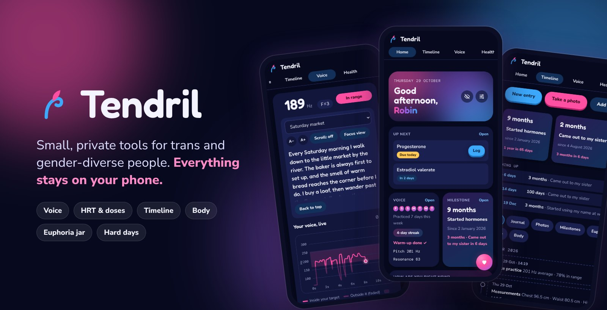

  <b>Voice practice · HRT tracking · Timeline · Body · Euphoria jar · Hard days</b> 
  No account. No server. No tracking. Everything stays on your phone.

  
  
  
  

  <a href="https://arash7m.github.io/Tendril/"><b>Open Tendril</b></a>
  &nbsp;·&nbsp;
  <a href="#install-it-on-your-phone">Install it on your phone</a>
  &nbsp;·&nbsp;
  <a href="#privacy">Privacy</a>

---

## Demo

  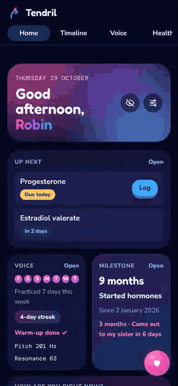

The home screen, the daily voice warm-up, a new moment in the euphoria jar, and breathing in hard day mode. Recorded with made-up sample data.

## What's inside

### 🎙️ Voice

Practise your voice with live feedback, a daily routine and games.

<table>
  <tr>
    <td width="25%">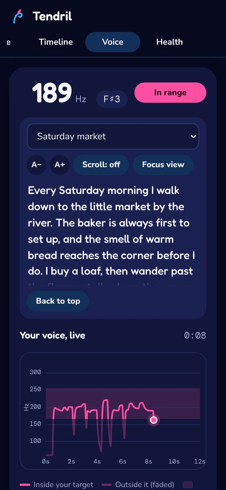</td>
    <td width="25%">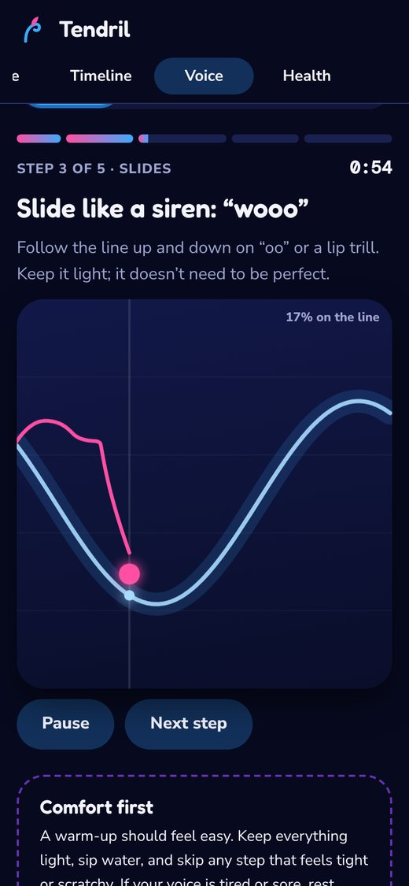</td>
    <td width="25%">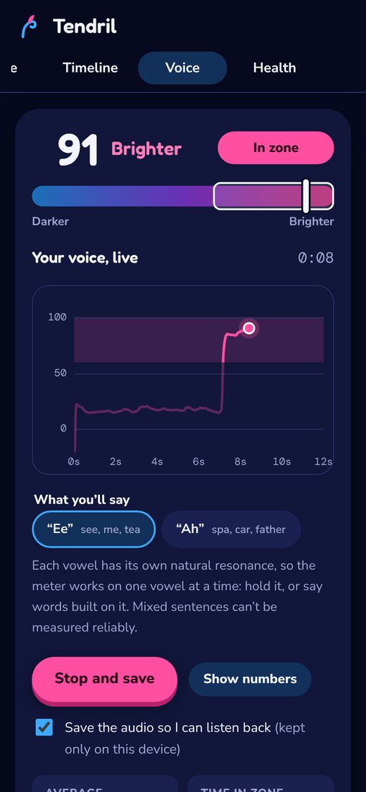</td>
    <td width="25%">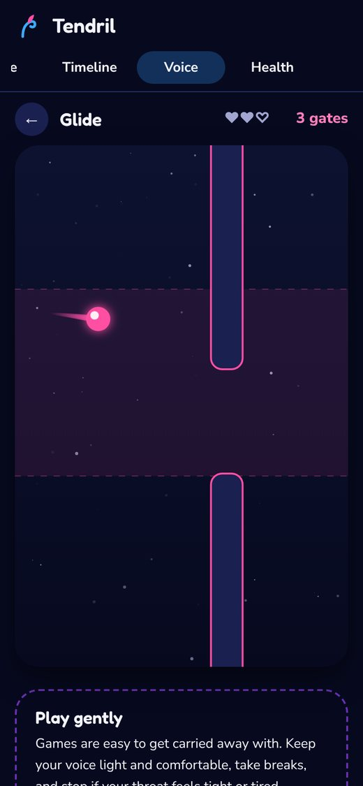</td>
  </tr>
  <tr>
    <td valign="top"><b>Pitch</b> A live graph against your target range, text to read aloud that scrolls as you speak, a full-screen focus view, and recordings you can play back.</td>
    <td valign="top"><b>Daily warm-up</b> A guided 5-minute (or 2-minute) routine: breathing, hums, siren slides, resonance and speaking in range. Builds a streak.</td>
    <td valign="top"><b>Resonance</b> A brighter ↔ darker meter measured on one vowel at a time, with target zones and guided exercises.</td>
    <td valign="top"><b>Games</b> Glide, Grow and Echo: steer, grow a vine and copy intonation, all using your own target range.</td>
  </tr>
</table>

### 💉 Health

<table>
  <tr>
    <td width="25%">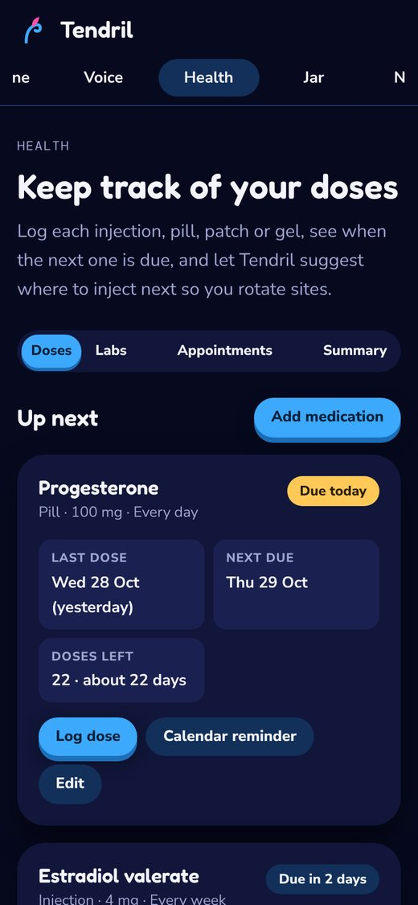</td>
    <td width="25%">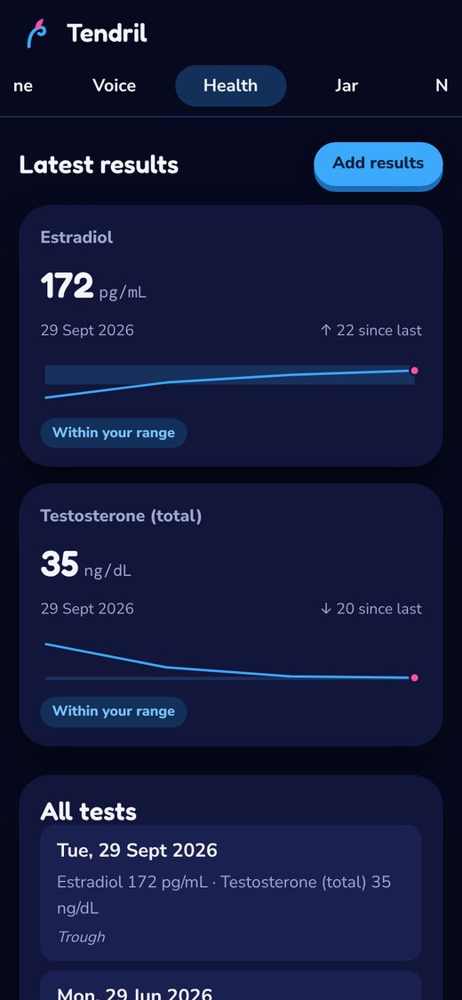</td>
    <td width="25%">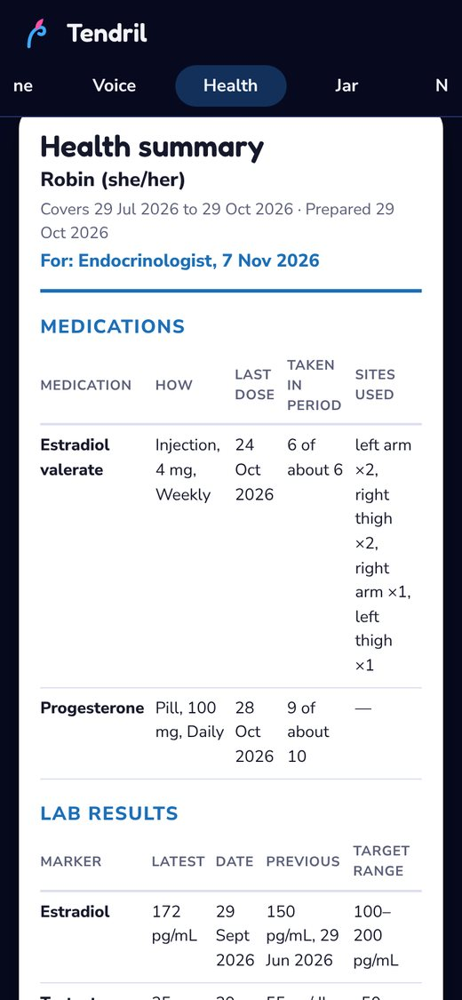</td>
    <td width="25%">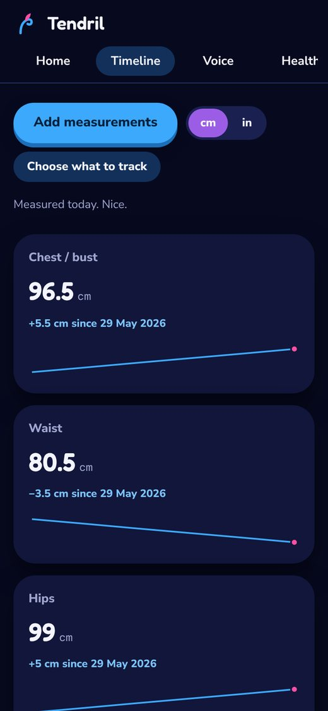</td>
  </tr>
  <tr>
    <td valign="top"><b>Doses</b> Injections, pills, patches and gel. See what's due, how many are left, and where to inject next on a body map. Calendar reminders.</td>
    <td valign="top"><b>Labs</b> Blood test results with charts and your doctor's target ranges. Common units convert automatically.</td>
    <td valign="top"><b>Doctor summary</b> One page for your appointment: doses taken, labs, mood, chosen notes, measurements and your questions. Print, save as PDF or copy.</td>
    <td valign="top"><b>Body</b> Chest, waist, hips and more over time, in cm or inches. Weight is optional and off by default.</td>
  </tr>
</table>

Appointments and blood tests get countdowns and calendar export too.

### 🌱 Your story

<table>
  <tr>
    <td width="25%">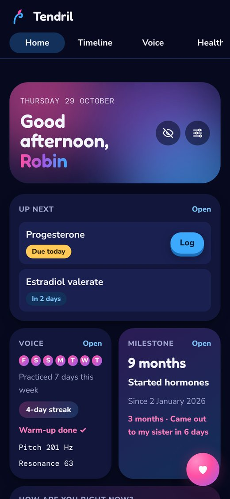</td>
    <td width="25%">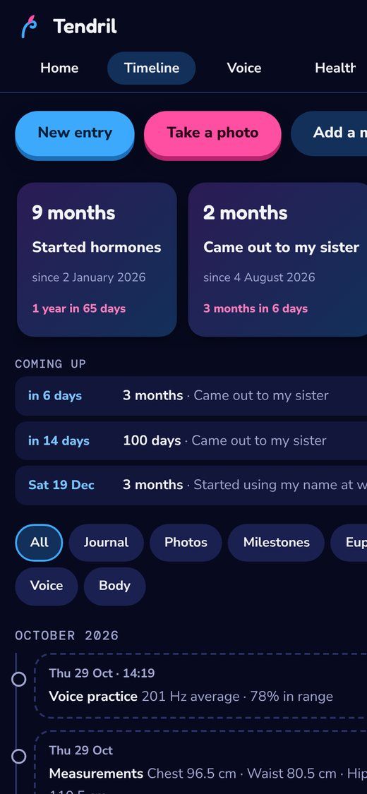</td>
    <td width="25%">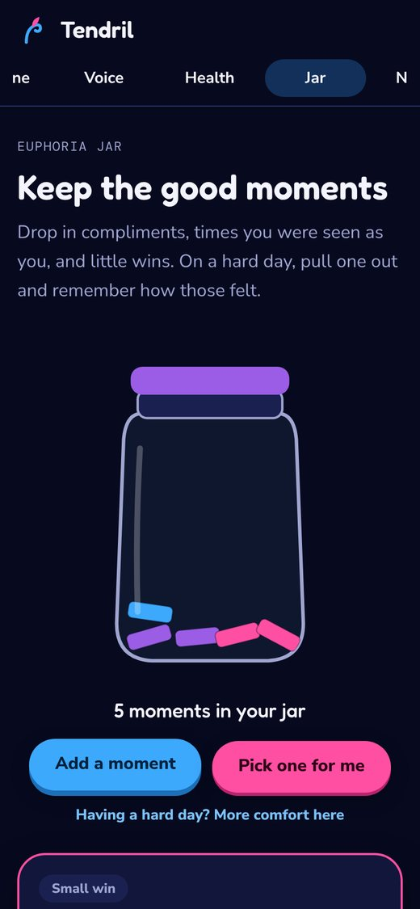</td>
    <td width="25%">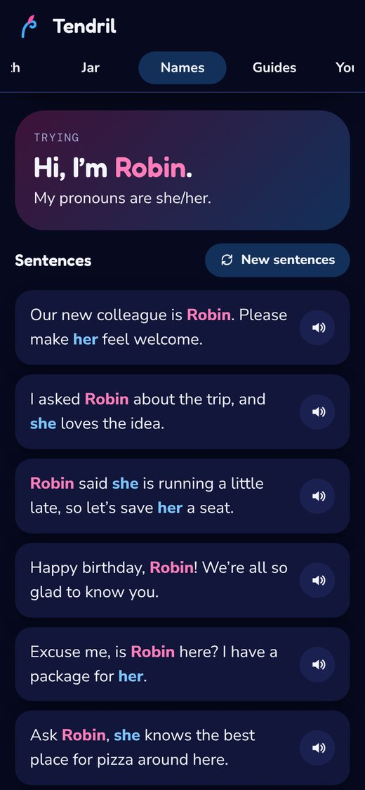</td>
  </tr>
  <tr>
    <td valign="top"><b>Home</b> Everything at a glance: doses due, your voice streak, milestones and a mood check-in. Discreet mode hides sensitive cards until tapped.</td>
    <td valign="top"><b>Timeline</b> A private journal and photo diary. Milestones with anniversaries and a little celebration on the day, plus before/after photo compare.</td>
    <td valign="top"><b>Euphoria jar</b> Save compliments, small wins and moments you felt like yourself, and pull one out on a hard day.</td>
    <td valign="top"><b>Names</b> Try a name and pronouns in everyday sentences, hear them read aloud, keep a shortlist, and browse the most popular names from the year you were born.</td>
  </tr>
</table>

### 🫶 For hard days

<table>
  <tr>
    <td width="25%">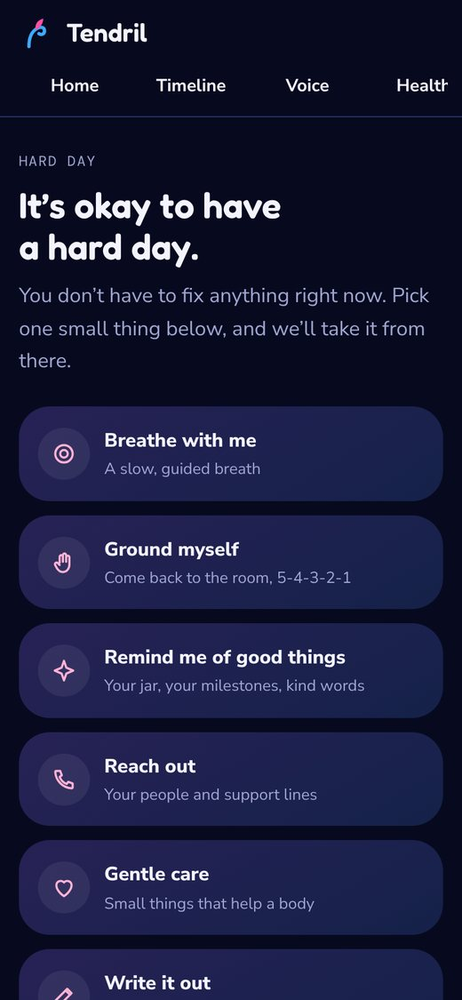</td>
    <td width="25%">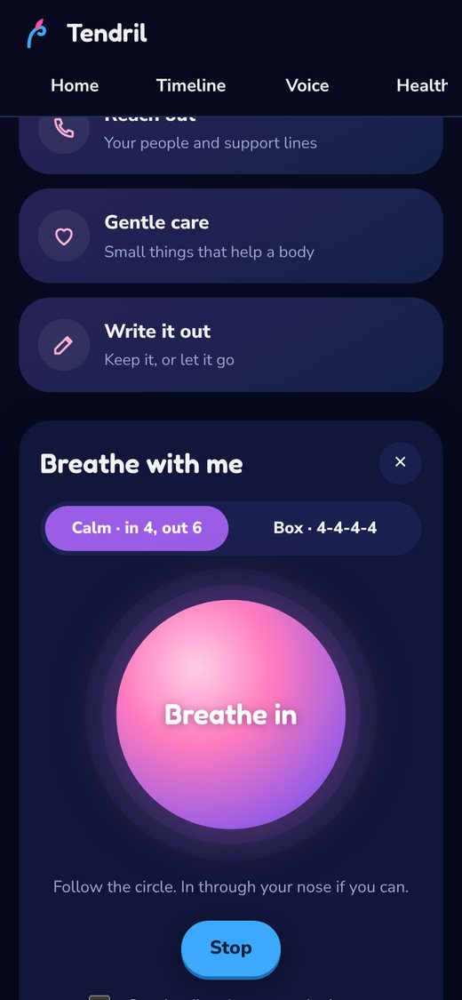</td>
    <td width="50%" valign="top">
      <b>Hard day mode</b> 
      A calmer page one tap away (the heart on the home screen):
      <ul>
        <li>a guided breathing circle</li>
        <li>5-4-3-2-1 grounding</li>
        <li>good things: your jar, how far you've come, kind words</li>
        <li>your trusted people with ready-to-send messages, and support lines</li>
        <li>a gentle care checklist</li>
        <li>a place to write it out, then keep it or let it go</li>
      </ul>
      <b>Coming-out helper</b> 
      Builds an editable letter, talking points or a short text from a few choices.  
      <b>Guides</b> 
      Binding, tucking, appointment prep and a name-change checklist.
    </td>
  </tr>
</table>

---

## Privacy

Tendril was made for people whose information is sensitive.

- **Everything is stored on your device.** There's no server, no account, no analytics and no trackers. Even the fonts are built in.
- **Microphone audio is analysed on your phone** and never uploaded. Recordings you choose to keep stay on the device.
- **Photos are cleaned:** location and camera details are removed, and they don't go to your phone's gallery.
- **Optional app lock:** a PIN encrypts all your data on the device.
- **Discreet mode** covers sensitive cards on the home screen until you tap them.
- **Backups are yours:** download a file (optionally password-encrypted) and restore it any time. A gentle monthly reminder helps you keep one.

[PRIVACY.md](PRIVACY.md) lists exactly what's kept, where, and the few things that ever touch the internet.

## Install it on your phone

Tendril is a web app that installs like a normal app and works offline.

- **Android (Chrome):** open the link, tap **⋮** then **Install app** (or **Add to Home screen**).
- **iPhone (Safari):** open the link, tap **Share** then **Add to Home Screen**.

When there's an update, the app shows an **Update** button.

## Known limitations

- **One device:** your data lives on the phone or computer where you use Tendril, with no sync. To move it, make a backup and restore it on the new device.
- **A forgotten PIN can't be recovered:** the data is encrypted with it. Keep a backup.
- **English only,** for now.
- **Resonance is measured on one vowel at a time** (“ee” or “ah”). Mixed sentences can't be scored reliably yet.
- **Voice readings depend on your microphone and surroundings:** a quiet room and the phone's own microphone work best.

## Good to know

Tendril is a community project and isn't medical advice. Health content is general information. Talk to your doctor about anything to do with hormones or health. The guides should be reviewed by trans community members and a clinician.

## Security

What protects your data, what it can't protect against, and how to report a problem privately: [SECURITY.md](SECURITY.md).

## License

Tendril is free software under the [GNU Affero General Public License v3.0](LICENSE). You may use, change and share it. If you share a changed version, or run one for others, you must offer its source code under the same license, so every copy of Tendril stays open and checkable.

Copyright © 2026 Arash Mashhadi.

---

Plain HTML, CSS and JavaScript with no build step, hosted on GitHub Pages. How it's built, where data lives and how to work on it: <a href="docs/DEVELOPMENT.md">developer notes</a>.
